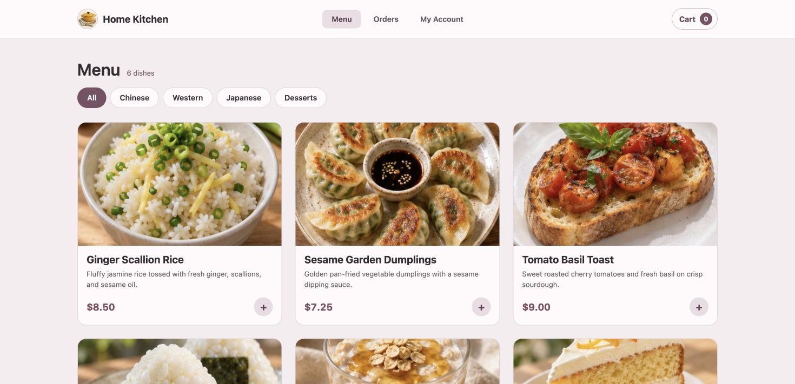

# Home Kitchen

[Try the live demo](https://home-kitchen-ordering-demo.onrender.com/)

Home Kitchen is a responsive ordering app built with Java 21 and Spring Boot. Guests browse a photo menu, read recipes, save favorites, and place orders. Managers edit dishes and move orders from Placed to Preparing to Completed.



## Try it online

1. Open **Menu** and select a dish to view its photo, ingredients, and preparation steps.
2. Go to **My Account** to create a guest account. Sign in to save favorites or place a sample order from **Cart**.
3. Open **Orders** to see your order status and total.

The live site uses fictional recipes and generated photos. The first page load may take longer after the service has been idle. To try the manager workflow, create a local manager using the instructions below.

## How it works

- Spring Boot serves the responsive interface and API from the same origin. Spring Data JPA handles persistence, and Flyway manages the PostgreSQL schema.
- Spring Security enforces guest and manager permissions. Guests can see their own orders. Managers can edit dishes, view all orders, and update kitchen status.
- Each order line stores the dish name and unit price at checkout. The server calculates totals using decimal arithmetic, so later menu edits leave historical receipts intact.
- PostgreSQL row locks serialize concurrent updates to the same order. The server rejects invalid status transitions with HTTP 409.

## Run locally

Install Java 21, Maven 3.9+, and PostgreSQL. Connect to PostgreSQL as a local administrator with `psql -d postgres`, then create a role and separate databases for the app and tests. The password prompt keeps the value out of the SQL you type.

```sql
CREATE ROLE home_kitchen LOGIN;
\password home_kitchen
CREATE DATABASE home_kitchen OWNER home_kitchen;
CREATE DATABASE home_kitchen_test OWNER home_kitchen;
```

From the repository root, supply the connection settings through your shell and start the app. Use the role password you just set for `DB_PASSWORD`. Flyway creates the tables and seeds the menu on startup.

```sh
export KITCHEN_MODE=public
export DB_URL=jdbc:postgresql://localhost:5432/home_kitchen
export DB_USER=home_kitchen
export DB_PASSWORD='<password chosen at the prompt>'
mvn spring-boot:run
```

Open [http://127.0.0.1:8080](http://127.0.0.1:8080). The app binds to loopback by default.

## Local accounts

Use **My Account → Create an account** to create a guest. Anyone can browse the public menu. Guests and managers both use **My Account → Sign in**. The account role determines access. A signed-in guest can place orders, view their own order history, edit their nickname, and manage favorites.

To create a local manager, stop the app if it is running. Keep the database settings from **Run locally**, then run these commands in Bash or Zsh. Choose a new password when prompted.

```sh
export KITCHEN_ADMIN_USERNAME=demo_manager
printf 'New local manager password: '
read -rs KITCHEN_ADMIN_PASSWORD
printf '\n'
export KITCHEN_ADMIN_PASSWORD
mvn spring-boot:run
```

The first startup with these variables creates the manager with a BCrypt password hash. Later startups keep that account's existing password. The manager can manage the kitchen avatar and dishes and sees all orders. Registration always creates a guest.

To change an existing manager's password on a local database, use the same `DB_URL`, `DB_USER`, and `DB_PASSWORD` as the application. The tool prompts for the new password without displaying it and writes only its BCrypt hash. It reports the database and schema after reading the committed hash from a new connection.

```sh
python3 -m venv .venv
.venv/bin/pip install 'psycopg[binary]' bcrypt
.venv/bin/python tools/set_local_manager_password.py demo_manager
```

## Try the manager workflow locally

1. In **Menu**, open **Ginger Scallion Rice** to view its photo, ingredients, steps, and tips.
2. Sign in as a guest. Add two **Ginger Scallion Rice** and one **Sesame Garden Dumplings**. Open **Cart**, confirm the **$24.25** estimate, and click **Place order**. Look up the order in **Orders**.
3. In a separate browser session, sign in as the manager and open **Orders**. Click **Start preparing** and then **Mark completed** on the same order.
4. Managers can choose **Add dish** in the menu or **Edit recipe** in a dish's detail view. JPEG and PNG uploads allow a preview and removal, with a 1 MB upload limit.

## Import a legacy menu locally

Create a separate local PostgreSQL database and start the Java app against it once so Flyway applies the schema. Use the same database URL for the import. Keep the legacy database and imported image data outside the repository.

```sh
python3 -m venv .venv
.venv/bin/pip install 'psycopg[binary]'
export LEGACY_IMPORT_DB_URL=jdbc:postgresql://127.0.0.1:5432/home_kitchen_legacy
.venv/bin/python tools/import_legacy_menu.py /path/to/legacy/kitchen.db
```

The script uses `DB_USER` and `DB_PASSWORD` from the shell, reads the SQLite `dish` table in read-only mode, and accepts a loopback PostgreSQL destination. It uses a stable category and dish-name key so reruns leave the imported records and subsequent edits intact. The script reports import counts and missing fields. A fresh application database includes the synthetic menu and creates no guest accounts.

## Deploy the English portfolio on Render

Create a Render Web Service with the Docker runtime. The Dockerfile starts Spring Boot on Render's assigned port. Set the health check path to `/healthz`.

| Variable | Value |
| --- | --- |
| `KITCHEN_MODE` | `public` enables anonymous menu browsing and guest registration. |
| `KITCHEN_LANGUAGE` | `en-US` is the default in public mode. |
| `DB_URL`, `DB_USER`, `DB_PASSWORD` | Use a dedicated PostgreSQL database for the fictional menu. Flyway seeds it on startup. |
| `KITCHEN_ADMIN_USERNAME`, `KITCHEN_ADMIN_PASSWORD` | Optional manager bootstrap. The password is stored as a BCrypt hash. |

For Neon, use a direct JDBC URL with certificate validation, for example
`jdbc:postgresql://<endpoint>/<database>?sslmode=verify-full&sslfactory=org.postgresql.ssl.DefaultJavaSSLFactory`.
Set database credentials and any bootstrap password in Render's environment settings.

The public [health endpoint](https://home-kitchen-ordering-demo.onrender.com/healthz) returns HTTP 200 with `ok` when the application is running. It requires neither a session nor a database query.

## Test with PostgreSQL

Use the separate database created above. The suite applies the Flyway migrations and rolls back its test data.

```sh
export TEST_DB_URL=jdbc:postgresql://localhost:5432/home_kitchen_test
export TEST_DB_USER=home_kitchen
export TEST_DB_PASSWORD='<password chosen at the prompt>'
mvn verify
```

The integration tests exercise the HTTP endpoints against PostgreSQL. They cover the shared login for guests and managers, logout, CSRF, guest and manager permissions, private order history, menu changes and deletion, image limits, nickname and favorites, the three-portion limit, and price snapshots.

## Ordering rules

Each order line uses a distinct dish ID and a whole-number quantity from 1 to 3. Unknown and sold-out dishes are rejected. Orders start in Placed and can move to Preparing, then to Completed.
