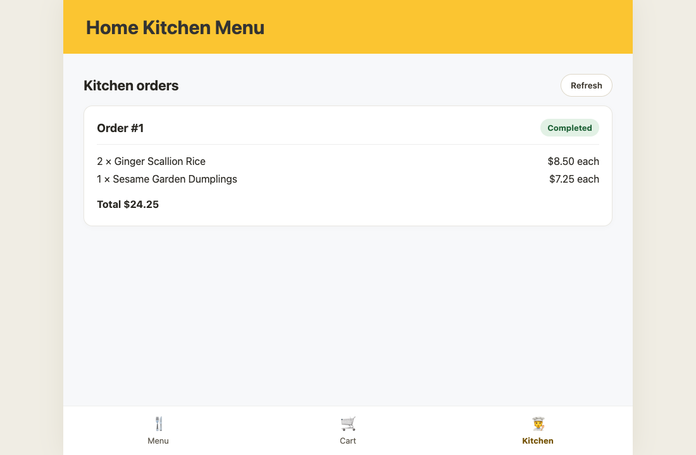

# Home Kitchen Menu

Home Kitchen Menu is a local ordering demo for a Java developer portfolio. A customer browses a menu, adds dishes and quantities to a cart, and places an order. The kitchen then prepares and completes it.

The application uses Java 21, Spring Boot, Spring Data JPA, PostgreSQL, and Flyway. Spring Boot also serves the HTML, CSS, and vanilla JavaScript from the original Flask app's menu and cart layout. The menu is seeded with fictional dishes, and the walkthrough creates its own sample order.

## Run locally

Install Java 21, Maven 3.9+, and PostgreSQL. Connect to PostgreSQL as a local administrator with `psql -d postgres`, then create a role and separate databases for the app and tests. The password prompt keeps the value out of the SQL you type.

```sql
CREATE ROLE home_kitchen LOGIN;
\password home_kitchen
CREATE DATABASE home_kitchen OWNER home_kitchen;
CREATE DATABASE home_kitchen_test OWNER home_kitchen;
```

From the repository root, supply the connection settings through your shell and start the app. Use the role password you just set for `DB_PASSWORD`. Flyway creates the tables and seeds the menu on startup.

```sh
export DB_URL=jdbc:postgresql://localhost:5432/home_kitchen
export DB_USER=home_kitchen
export DB_PASSWORD='<password chosen at the prompt>'
mvn spring-boot:run
```

Open [http://127.0.0.1:8080](http://127.0.0.1:8080). Both views are available in the same browser. The demo binds to loopback by default and requires no customer or kitchen accounts.

## Demo walkthrough

1. In **Menu**, browse the cuisine categories. In **Chinese**, add two **Ginger Scallion Rice** and one **Sesame Garden Dumplings**.
2. Open **Cart**, confirm the quantities and the **$24.25** estimate, then click **Place order**. The confirmation shows the order number and the total returned by the backend.
3. Open **Kitchen** and find the order in **Placed** status. Click **Start preparing** and confirm it changes to **Preparing**.
4. Click **Mark completed**. Refresh the kitchen list and verify that the same order still shows **Completed**, with its original items and total.



## Test with PostgreSQL

Use the separate database created above. The suite applies the Flyway migrations and rolls back its test data.

```sh
export TEST_DB_URL=jdbc:postgresql://localhost:5432/home_kitchen_test
export TEST_DB_USER=home_kitchen
export TEST_DB_PASSWORD='<password chosen at the prompt>'
mvn test
```

The integration tests exercise the HTTP endpoints against PostgreSQL. They cover menu availability, invalid quantities, duplicate lines, unavailable dishes, order totals after menu changes, and the forward-only kitchen workflow.

## Ordering rules

- Each order line uses a distinct dish ID and a whole-number quantity from 1 to 99. Unknown and sold-out dishes are rejected.
- The server reads the current menu price, records the dish name and unit price on the order line, and calculates the order total using decimal arithmetic. Later menu edits leave the saved receipt intact.
- The kitchen accepts only `Placed → Preparing → Completed`. It serializes concurrent updates to the same order with a database row lock and rejects invalid transitions with HTTP 409.
